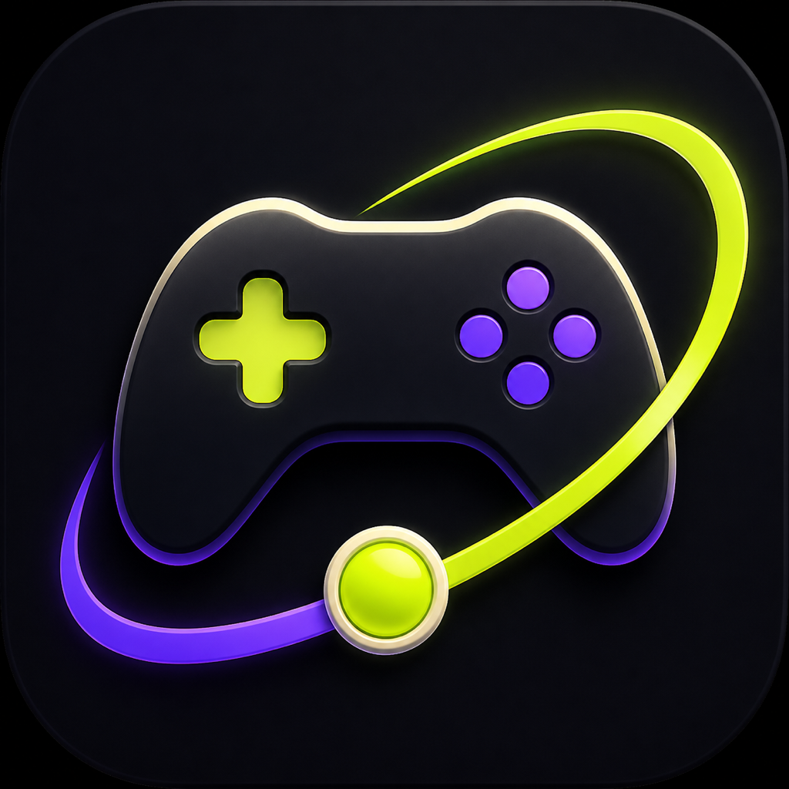
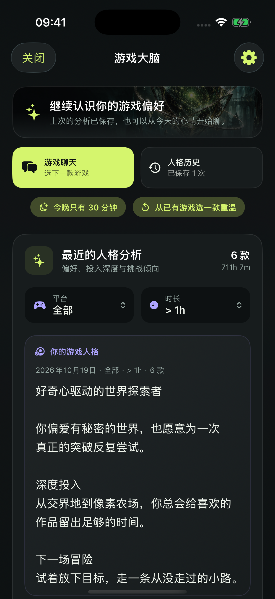
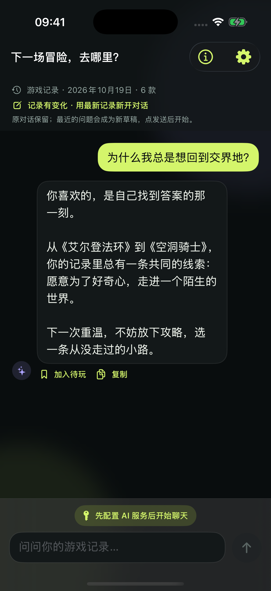
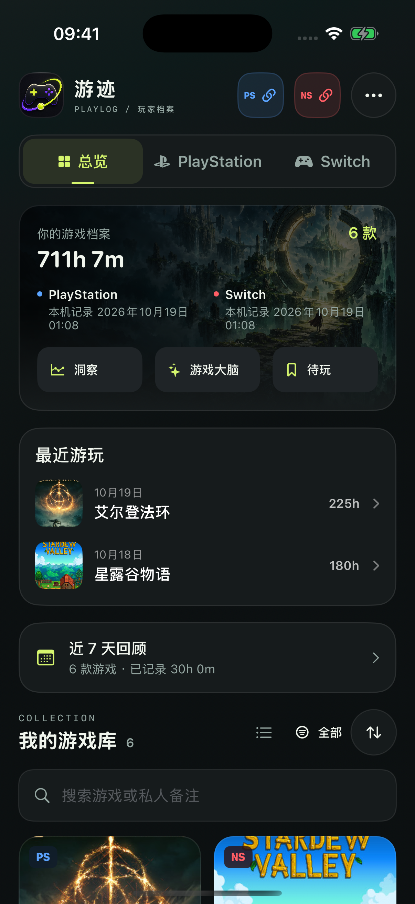
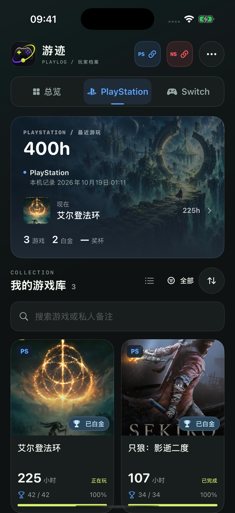
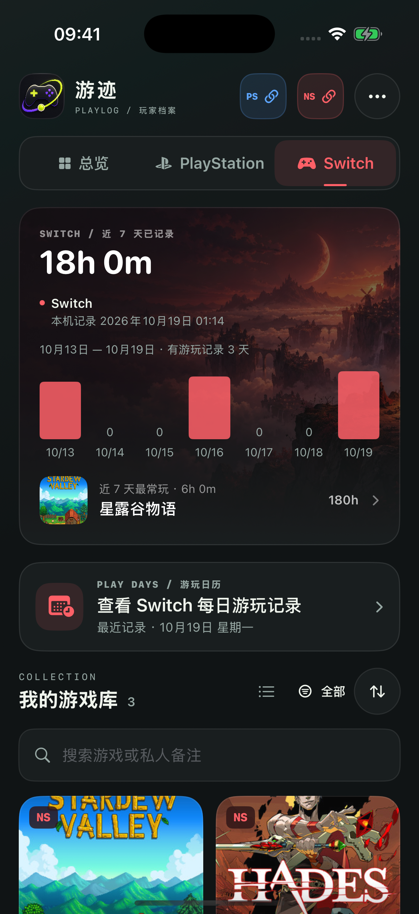

<p align="center">
  
</p>

<p align="center">
  English · <a href="README_ZH.md">简体中文</a>
</p>

<h1 align="center">YouJi</h1>

<p align="center">
  <strong>Your game brain</strong>
</p>

<p align="center">
  Turn your PlayStation and Nintendo Switch history into a personal library that understands you.
</p>

YouJi organizes the games you have actually played, the time you invested, and the trophies you earned. Its AI builds on that history to reveal your tastes and habits—and to help you choose the next adventure worth starting.

## Screenshots

The new **Midnight Archive** design pairs original adventure art with a dark, cover-first library, a list option, cinematic game details, and a unified Game Brain interface. [Preview the redesign](docs/DESIGN.md). The simulator previews below use fictional play history.

<p align="center">
  <strong>Game Brain</strong>
</p>

<p align="center">
  
  
</p>

<p align="center">
  <strong>Local Game Library</strong>
</p>

<p align="center">
  
  
  
</p>

## It understands your history, not just your genres

### Discover your gaming personality

Use the games you genuinely invested in to uncover your core preferences, depth of engagement, and appetite for challenge. Choose a platform and scope so each analysis answers what matters to you right now.

### Talk to an AI that already knows what you play

No spreadsheets, pasted lists, or repeated explanations. Ask why Soulslikes resonate with you, which game deserves another playthrough, or what to start next. YouJi answers from your own history and keeps the conversation coherent as you follow up.

### Turn your game profile into an image

Ask for an image directly in the chat composer, or generate a **game portrait** from a saved personality analysis. Chat automatically chooses a text reply or an image tool call; no mode switch is needed. Images stay with their conversation or profile, can be saved to Photos or shared, and are included in complete backups. Generation is always explicit and uses your OpenAI API quota. Chat drawing creates a new image from text context; it does not edit the pixels of earlier images. Chat uses a compact layout with smaller default text that still respects Dynamic Type.

### Keep the conversations worth returning to

Each new message also captures the latest 30 days of local play activity, including dates, minutes, short sessions, and available trophy changes. Known daily activity and PlayStation synchronization intervals are distinguished, and your PS date allocations take precedence without double-counting. This reads local history only; retrying a message reuses its original activity snapshot.

Chats are saved locally and organized into easy-to-find topics. Continue an existing conversation, start a new one, or delete anything you no longer need.

## A console history that is truly yours

- **One cross-platform library:** See PlayStation and Nintendo Switch games, play time, totals, and recent activity in one place.
- **Trophies and platinums:** Revisit PlayStation trophy progress, completion rates, and every platinum you worked for.
- **Recent activity:** Understand your Nintendo Switch rhythm through a focused seven-day view.
- **Play calendar:** Keep exact Switch play dates and per-game minutes on device after each sync, even after they leave Nintendo's seven-day window.
- **PlayStation play dates:** Quietly adjust a time increase from a game’s More menu, split it across actual play dates, or restore its original distribution. Timelines, cumulative charts, weekly reviews, and period totals share the same dates while original platform records stay intact.
- **Long-term trends:** Review seven-day, 30-day, and annual changes in play time and trophies, with calculation details available only when you ask for them.
- **A home that follows your progress:** Start with direct platform connection buttons; return to a compact archive, recently played games, visible update times, and a local seven-day recap. The full library keeps its play-time sorting and cover/list choice.
- **Searchable game archive:** Search by title or note, open a game timeline, and add favorites, visibility, status, and private notes.
- **Recoverable sync:** See per-platform stages and trophy progress, browse already-saved PS games, and reconnect or retry directly. Titles without a PSN trophy record do not trigger a failure warning and are checked again on your next manual sync. Old records remain available when part of a sync fails.
- **Account-aware history:** See which account is connected, inspect dated sync receipts, and reopen disconnected local archives without mixing accounts.
- **A cleaner collection:** Keep meaningful games in focus while short trials and long-forgotten launches stay out of the way.
- **Portable local data:** Export a complete backup or game-library table, restore by merging, and remove an account archive or all local content when you choose.
- **Built for the long term:** Sync when you choose, optionally enable a weekly local reminder, keep your covers and history on device, and let the library grow with you.

## Get started in three steps

1. Connect your PlayStation or Nintendo Account.
2. Sync your activity to build a cross-platform game library.
3. Open Game Brain to generate a profile or talk through what to play next.

AI features use your own model configuration, which you can add in Settings the first time you use them.
YouJi connects directly to OpenAI. Enter your own OpenAI API key in Settings and configure text and image models separately (defaults: `gpt-6-luna` and `gpt-image-2.6-flare`). The former service and custom endpoint configuration have been removed; its key is not reused. Saving sends no game data, and the connection test sends only a short text request.

Game Brain reopens your latest saved profile and its original filters. Profile follow-ups and short-session/replay prompts create editable drafts; sending remains explicit. Chats preserve drafts and their original game snapshot, and can start a new conversation with updated local records. Saved suggestions can be read in full, edited, linked to a game, and used to mark that game as playing.

## Your data stays under your control

- Game records and conversations are stored locally first.
- YouJi contacts platform or AI services only after an action you initiate.
- Account credentials and your AI API key are protected by the system and never become part of your game library or this repository.
- The AI receives only the information needed for the analysis or conversation, never your platform credentials.
- AI conversations are separated by the local account scope, personality results can be revisited and shared as image cards, and useful replies can be saved to a local play/replay list.
- Complete backups never include platform credentials or the AI API key.
- Backup v4 adds generated images and image drafts while preserving PlayStation date allocations and reset history. It also carries chat drafts, plan links, profile input fingerprints, and stable Switch window dates; older backups remain readable.
- Backup v4 preserves unreadable conversation data and still imports v1/v2/v3 backups. Restore validates account identities before writing and can repair damaged conversation components from an older readable backup.
- Failed writes leave the visible archive unchanged. Deleting, disconnecting, or restoring invalidates older in-flight requests so they cannot repopulate the archive.
- If the database cannot open, a recovery screen lets you export its original files or restore a JSON backup into a new database while keeping the original. A raw recovery package preserves files for recovery work; it is not a JSON backup.

Read the full [Privacy Policy](docs/PRIVACY_POLICY.md).

---

## Development

### Requirements

- iOS 17+
- Xcode 26 recommended
- Swift 6

### Build and run

1. Clone the repository and open `YouJi.xcodeproj`.
2. Select your development team under **Signing & Capabilities**.
3. When installing on a physical device, use a Bundle Identifier available to your Apple Developer account.
4. Select the `YouJi` scheme and run.

```bash
xcodebuild \
  -project YouJi.xcodeproj \
  -scheme YouJi \
  -destination 'platform=iOS Simulator,name=iPhone 17 Pro' \
  build
```

The simulator is suitable for exploring the interface. Connecting real PlayStation and Nintendo accounts requires a physical device.

### Build on GitHub, install on your iPhone

The manual **Build iPhone IPA** GitHub Actions workflow runs tests and produces an unsigned Release IPA without Apple credentials. Import it into AltStore / SideStore to sign and install on your phone. After the sideloading tool's initial computer setup, its remote refresh mode can renew apps without keeping your Mac on. Free Apple accounts still require renewal before the seven-day expiry. See the [phone installation guide](docs/PHONE_INSTALL.md).

### Stack

- SwiftUI for the interface
- SwiftData for game records, sync snapshots, and AI conversations
- Swift Charts for per-game cumulative-time charts and Nintendo Switch activity
- AuthenticationServices and WebKit for platform sign-in
- Keychain Services for platform sessions and the user-provided AI API key
- URLSession for platform sync and AI requests
- CryptoKit for cover-cache filenames

Cover images are cached under `Application Support/YouJi/Covers`. Platform sessions use the `AfterFirstUnlockThisDeviceOnly` Keychain accessibility level.

### Project structure

```text
YouJi/
├── Assets.xcassets/       # App icon and brand assets
├── Design/                # Theme and shared view styling
├── Models/                # SwiftData game, snapshot, conversation, profile, and play-plan models
├── Services/              # Platform sync, AI, Keychain, backup, trends, reminders, and cover caching
├── Views/                 # Dashboard, game archive, insights, account/data management, Game Brain, and settings
└── YouJiApp.swift         # App entry point

docs/
├── ARCHITECTURE.md        # Data flow, storage, and sync design
└── screenshots/           # README screenshots with metadata removed

YouJiTests/                # Model, parsing, prompt, and persistence regression tests
```

See the [product requirements](docs/PRD.md) for the current product scope, user journeys, screen map, and prioritized gaps. The [architecture notes](docs/ARCHITECTURE.md) describe the current data flow and platform sync design. Maintainers can refresh the native-resolution images with the [real-device screenshot workflow](docs/SCREENSHOT_WORKFLOW.md). Before making AI-assisted changes, read the [AI contributor guide](AGENTS.md) for product invariants, security boundaries, and verification steps.

### Platform API notes

The PlayStation and Nintendo activity endpoints used by this project are not stable public third-party APIs. When platform behavior changes, start with:

- `YouJi/Services/PlayStationAPIClient.swift`
- `YouJi/Services/NintendoAPIClient.swift`

## Disclaimer

This is an independent project for personal use and learning. It is not affiliated with Sony Interactive Entertainment or Nintendo. PlayStation, PS4, PS5, Nintendo Switch, and related marks belong to their respective owners.

## License

YouJi is available under the [MIT License](LICENSE).
