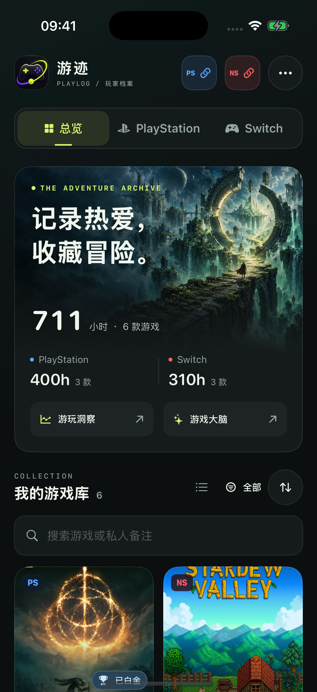
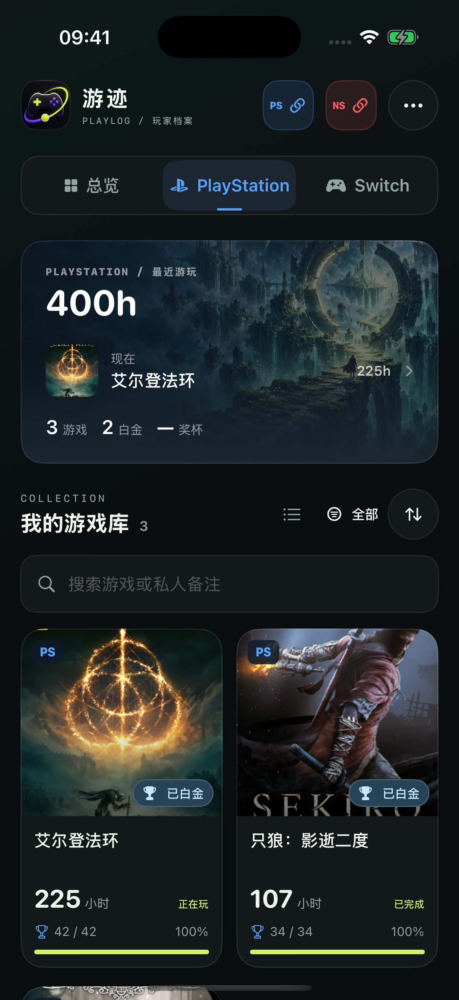
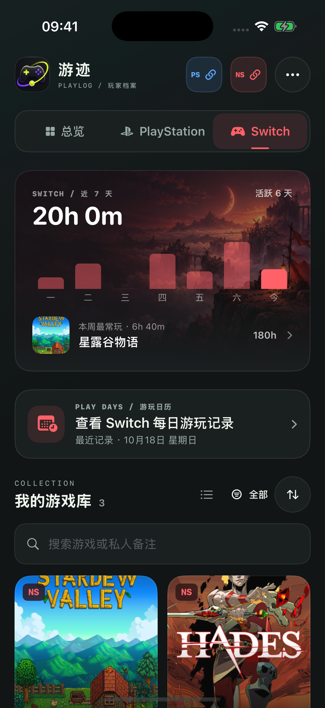
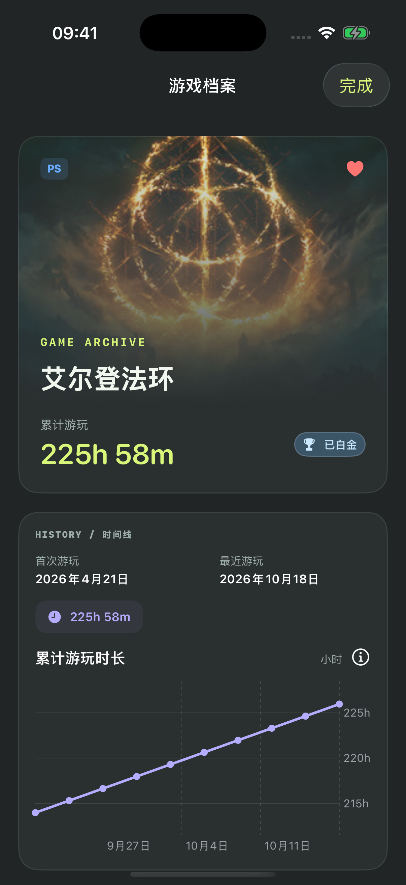
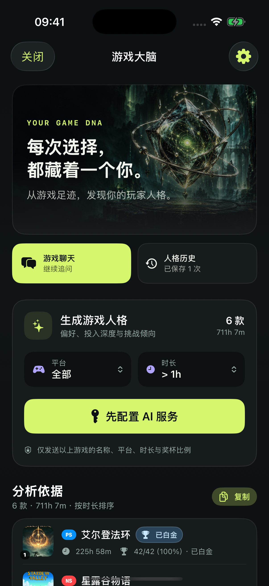
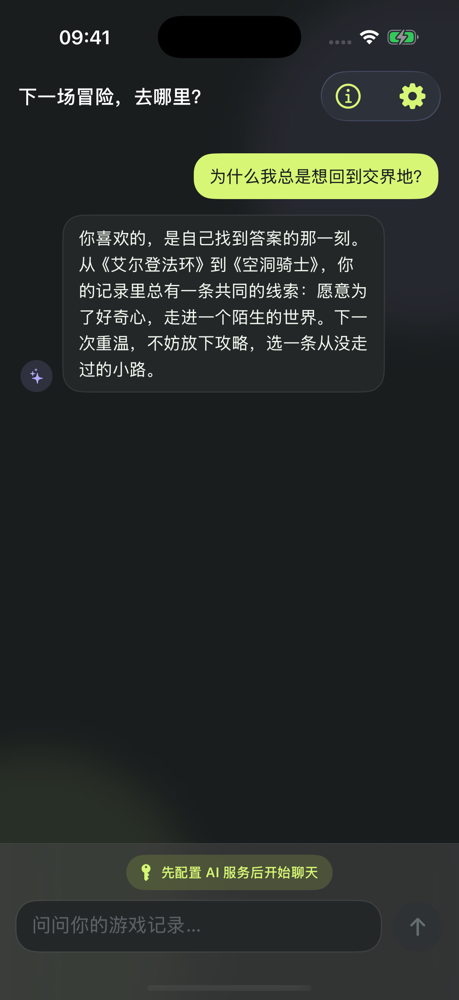

# 深夜冒险档案 · 美术规范

这次视觉重设计以主机游戏的概念设定集与玩家收藏册为方向。界面使用深墨底色、青柠主色与低对比描边，保留原有游迹图标；PlayStation 为蓝色、Switch 为红色，白金使用独立冰蓝标记。

## 产品优化后的当前界面

2026-10-19 已按产品评审压缩回访首页与已有 AI 人格的主视觉，增加首次连接引导、最近游戏和行动入口。[查看当前界面与验收](PRODUCT_ROADMAP.md)。下方图片保留第一轮纯美术改版的记录。

## 运行预览

以下是 iPhone 17 Pro / iOS 26.2 的实际运行截图，使用独立内存数据库中的示例数据。

<p>
  
  
  
</p>
<p>
  
  
  
</p>

## 界面

- 首页：原创冒险场景、累计时长与平台统计、洞察和游戏大脑入口。
- 游戏库：默认封面墙，可切换列表；布局偏好只存本机。辅助功能大字号自动使用列表，游戏排序和筛选规则不变。
- 游戏详情：游戏封面作为主视觉，时长与白金在独立信息区展示。
- 游戏大脑：原创记忆水晶、原生可选文字与明确生成操作。聊天、设置、平台连接和其他辅助页沿用相同表面与色彩。
- 插画只承载氛围，不烘焙文字和数据。重要文案使用系统相对字体，所有图像在本地随应用打包。

## 原创资源

通过内置 image_gen 工具生成，转为 JPEG 以控制包体；未使用 CLI/API 回退。原有 AppIcon 与 BrandIcon 保留。

| 文件 | 用途 |
| --- | --- |
| `YouJi/Assets.xcassets/ArchiveWorld.imageset/ArchiveWorld.jpg` | 首页与连接页的遗迹传送门 |
| `YouJi/Assets.xcassets/MemoryCrystal.imageset/MemoryCrystal.jpg` | 游戏大脑与聊天的记忆水晶 |
| `YouJi/Assets.xcassets/TwilightCamp.imageset/TwilightCamp.jpg` | Switch 的暮色营地 |

### ArchiveWorld 最终提示词

```text
Use case: stylized-concept
Asset type: original premium iPhone gaming library hero background, wide landscape 1536x1024.
Primary request: an extraordinary, atmospheric game key art landscape for "YouJi", an archive of a player's adventures. Original world, no recognizable franchise.
Scene: a solitary tiny caped traveler seen from behind on an ancient dark stone bridge, approaching a monumental broken circular portal floating over an emerald abyss; layered distant floating islands, crystalline ruins and fine drifting particles under a midnight petrol-blue sky. A soft luminous chartreuse path leads toward the portal, the aperture has subtle pale gold glow. Lush moss, sharp obsidian forms, mist with depth.
Style: exquisite painterly AAA adventure concept art, sophisticated cinematic matte painting, detailed and tactile, curated art-book quality, restrained saturation, no cartoon, no generic AI glossy 3D.
Composition: landscape, portal and traveler on the RIGHT half, leftmost 45 percent is deep dark teal mist and quiet negative space for live UI text; bottom 25 percent fades naturally into near-black. Full bleed, no frame.
Palette: near-black #0B100F, rich forest teal, petrol blue, restrained luminous yellow-green #D7F66B; a few silver highlights.
Lighting: mysterious, inviting, dramatic scale, soft atmospheric rays and rim light, deep shadows.
Constraints: pure artwork only, no text, no letters, no logos, no interface, no watermark. Beautiful even when cropped to 2:1 horizontal.
```

### MemoryCrystal 最终提示词

```text
Use case: stylized-concept
Asset type: wide landscape art for an iPhone gaming companion's "game brain" page, 1536x1024.
Primary request: a mysterious luminous archive crystal, an original otherworldly intelligence that holds a player's adventures.
Scene: an intricate floating translucent smoky-glass polyhedral artifact containing a miniature constellation of tiny chartreuse stars, orbiting fine platinum rings and fragments, hovering over a circular ancient dark stone plinth. Deep emerald and midnight teal cavern mist, subtle glowing filaments, tactile obsidian materials, sophisticated fantasy science-fiction blend.
Style: premium video game inventory relic, painterly cinematic art direction with realistic material detail, elegant, extraordinary craft, restrained not garish; no cartoon robots, no brain anatomy.
Composition: artifact on RIGHT 60 percent, quiet nearly black negative space on left 40 percent reserved for live interface text. Black lower margin. Full bleed landscape, carefully composed object silhouette.
Colors: dark #0B100F, cool forest teal, chartreuse #D7F66B and pale silver. Soft spectral rim lighting, fine grain.
Constraints: pure illustration, no text, no labels, no UI, no watermark, no brand logos.
```

### TwilightCamp 最终提示词

```text
Use case: stylized-concept
Asset type: original background artwork for the Nintendo Switch section of a premium game activity archive. Landscape 1536x1024, no branding.
Primary request: a poetic, inviting adventure landscape that contrasts with dark emerald ruins while belonging to the same crafted art book.
Scene: a tiny lantern-lit campsite with a red cloth pennant and a small traveler on the RIGHT foreground cliff, overlooking a vast sea of clouds and whimsical faraway islands at dusk. Warm coral-red crescent moon, terracotta rocks, plum and deep burgundy shadows, subtle amber lantern glow. Tiny distant windmills and stone arches emerge through mist. Restrained, sophisticated, magical, relaxing.
Style: outstanding painterly adventure-game environment art, gorgeous textured brushwork, cinematic light and layered atmospheric depth. Stylized shapes with fine detail, no shiny toy-like 3D, no familiar characters or recognizable franchise.
Composition: quiet dark aubergine sky and mist in LEFT 50 percent for white live UI text and activity chart, campsite and islands concentrated on right. Bottom quarter dark wine near-black gradient from natural scenery. Wide full bleed image.
Palette: near-black #110F14, deep burgundy, muted dusty coral, a little warm luminous apricot; avoid neon, oversaturation, pink candy.
Constraints: no text, no interface, no logos, no watermark.
```

## 复现视觉预览

Debug 模拟器专用启动参数 `--youji-design-preview` 使用独立内存数据库和虚构游玩数据，不向正式档案插入记录。发行构建及真机不启用。可与现有 `--youji-screenshot-route` 搭配，查看 overview、playstation、switch、ai-analysis、ai-chat、game-detail-playstation 等页面。

```bash
xcrun simctl launch booted com.youji.playlog --youji-design-preview --youji-screenshot-route overview
```

预览封面来自各游戏在 Steam CDN 的宣传素材，权利归原发行方所有；仅在主动开启的开发预览中作为示例封面，首次显示需要网络。原创界面插画完全本地可用。预览不代表真实账号数据，也不验证平台同步。


## 验证记录 · 2026-10-18

- 非签名 iOS Simulator Debug 构建通过。
- iPhone 17 Pro 上 54 项现有单元测试全部通过。
- Info.plist、6 个 Asset Catalog JSON 及资源引用检查通过。
- 检查 iPhone 17 Pro / iOS 26.2 的主要页面截图，以及 iPhone SE / iOS 17.2 的首页与辅助功能字号；大字号统计纵向排列，游戏库使用列表。
- 本次未验证真实账号同步，也未发送 AI 分析请求。
