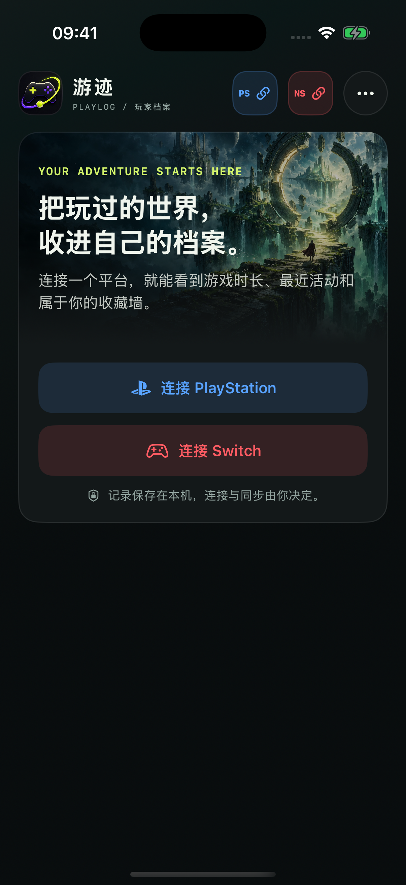
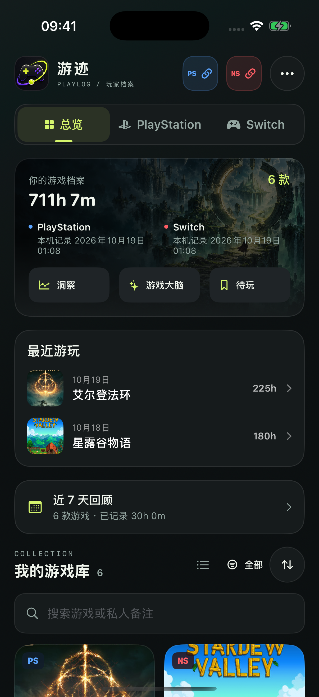
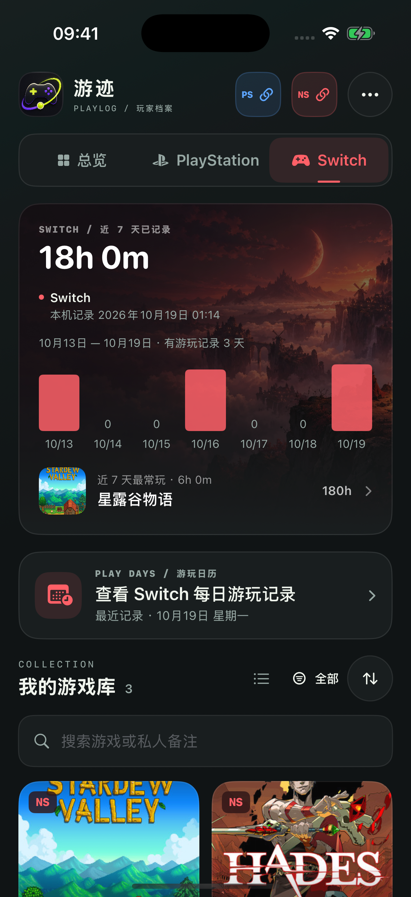
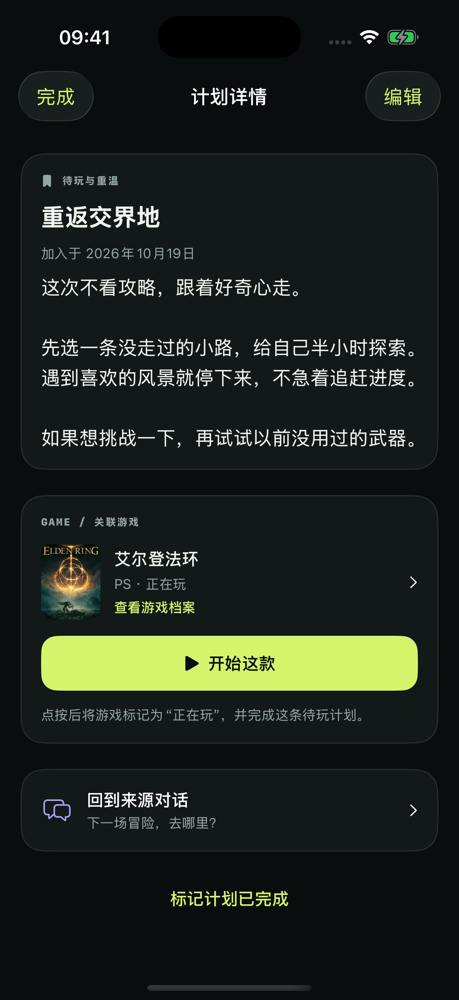
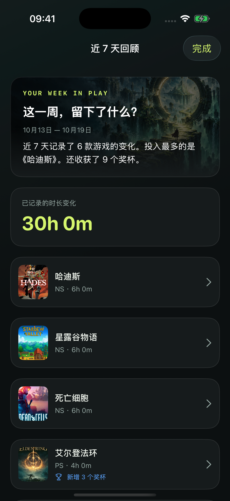
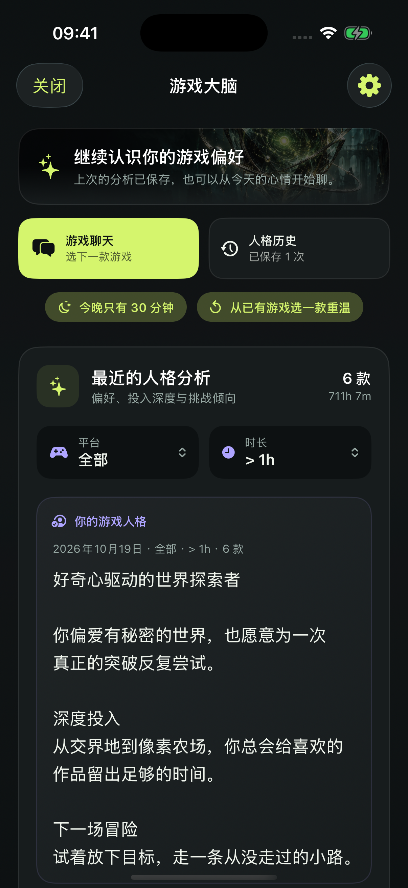
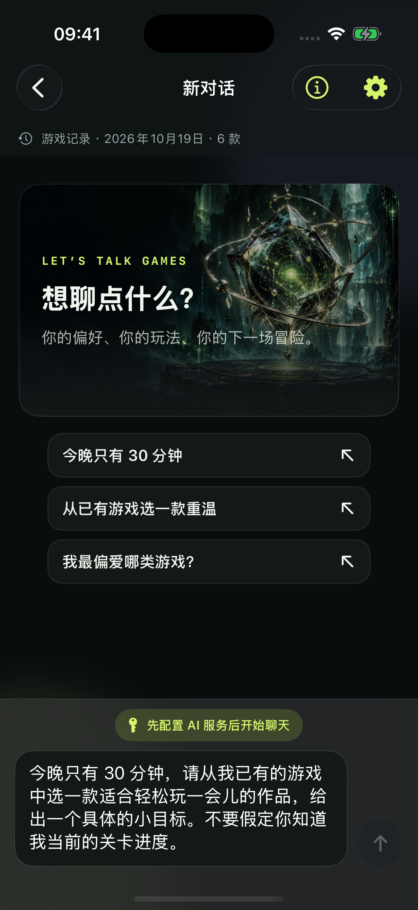
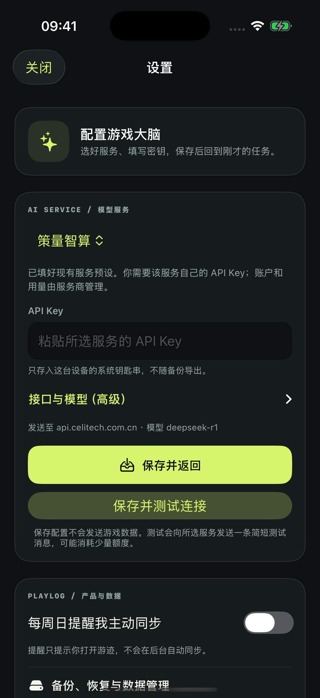

# 游迹产品完善计划

## 执行方式

- **模式**：自主连续实施
- **原则**：先保证数据可解释、可迁移，再增加长期回访与 AI 行动闭环
- **提交**：本轮不自动创建 Git 提交
- **验证**：每阶段静态检查，最终执行单元测试、资源检查和非签名模拟器构建

## 交付清单

- [x] **1. 数据归属与迁移基础**
  - 构建：为游戏增加收藏、手动隐藏、备注和游玩计划状态；为 AI 会话增加账号范围；增加人格历史与待玩灵感模型。
  - 验收：旧数据可用默认值打开；新数据按账号范围保存；不会把凭据写入 SwiftData。
  - 验证：模型持久化与账号范围单元测试。

- [x] **2. 同步可信度与账号中心**
  - 构建：按平台保存最后成功同步时间、同步变化摘要、PS 奖杯失败数；展示当前账号与历史本地档案；断开连接二次确认。
  - 验收：用户能回答“当前是谁、数据多新、本次变化什么、是否有部分失败”。
  - 验证：同步摘要计算测试及界面状态检查。

- [x] **3. 可查找的游戏档案**
  - 构建：首页搜索与筛选；游戏详情展示时间、奖杯、同步快照变化、Switch 日历；支持收藏、隐藏、备注和状态。
  - 验收：大型游戏库无需滚动查找；每款游戏有长期档案；手动隐藏可恢复。
  - 验证：筛选规则测试与详情页预览/构建。

- [x] **4. 数据备份与用户控制**
  - 构建：导出完整 JSON 备份和可读 CSV；从 JSON 恢复；按账号或全部删除；导出诊断摘要但不包含凭据。
  - 验收：游戏、快照、日历、AI 会话、人格和待玩灵感可移植；Keychain 内容永不进入备份。
  - 验证：备份编码/解码与往返恢复测试。

- [x] **5. AI 沉淀与行动闭环**
  - 构建：会话按账号范围隔离；保存历次人格；分享人格卡；明确服务商与测试连接；聊天支持停止、重试、复制和保存待玩灵感。
  - 验收：换账号不串会话；AI 结果关闭后仍可找回；建议可转化为下一步行动。
  - 验证：账号过滤、人格持久化和聊天失败恢复测试。

- [x] **6. 回访洞察**
  - 构建：使用 `PlaySnapshot` 生成 7 天、30 天和年度新增时长/奖杯；展示“从上次同步以来”；提供年度回顾与待玩清单。
  - 验收：同步历史不再只是内部数据；重复同步后能形成可见趋势。
  - 验证：快照差值边界测试。

- [x] **7. 提醒、无障碍与上架说明**
  - 构建：用户主动开启每周本地同步提醒；补齐 VoiceOver、动态字体、隐私说明、反馈/诊断入口和最新截图说明。
  - 验收：默认不通知、不自动同步；开启前解释用途；关键控件可被辅助功能理解。
  - 验证：Info.plist、资源 JSON、关键无障碍标签与通知授权路径检查。
  - 上架：`docs/PRIVACY_POLICY.md` 提供可公开托管的中英隐私政策；发布前确认仓库页面无需登录即可访问。

- [x] **8. 回归验证**
  - 构建：更新 README、架构和更新日志；修复所有编译与测试问题。
  - 验收：无生成物污染仓库，既有产品不变量保持成立。
  - 验证：`plutil`、`jq`、`git diff --check`、`xcodebuild build`、`xcodebuild test`。

## 2026-10-19 · 产品评审优化

- [x] 状态化首页：首屏连接、紧凑总览、最近游戏、同步新鲜度与分类空态。
- [x] 同步阶段进度、列表先浏览、分平台直接重连/重试和部分成功说明。
- [x] Switch 稳定日期窗口，区分未知/零，防止跨日或跨时区重复。
- [x] 详情快捷操作与待玩全文、编辑、关联游戏、来源对话、显式开始。
- [x] 人格历史默认恢复、原筛选延续、内容变化提示及人格追问草稿。
- [x] 短时游玩/重温情境、持久草稿、中断重试和旧快照新开对话。
- [x] AI 服务预设、高级自定义、校验与保存后回原任务。
- [x] 本地近七天回顾、旧数据库和备份兼容。

真机账号授权、实际同步耗时和真实服务商连接仍需用真实设备单独验收；模拟器使用拦截网络和内存凭据测试，不代表平台线上验证。

## 本轮验收与预览

- 非签名模拟器 Debug 构建通过，iPhone 17 Pro 上 **90 项测试通过、0 失败**（原有 54 项 + 新增 36 项）。
- 新增回归覆盖稳定自然日/跨时区、未知与零的区分、按账号回顾、PS 列表先保存与部分奖杯失败、待玩完整身份与原子开始、旧 SQLite 升级、备份往返、草稿保全、旧会话迁移和新会话 UI 上下文归属。
- iPhone SE / iOS 17.2 已走通首页到计划全文、开始游戏、返回来源对话及最新记录创建草稿的交互；没有发送真实模型请求。
- Info.plist、资源 JSON 与差异空白检查通过。真实平台账号与服务商调用未作为模拟器验收结论。

以下截图为 iPhone 17 Pro / iOS 26.2 的实际运行画面，使用独立内存示例数据。

  
  
  

  
  
  

  
  
  

